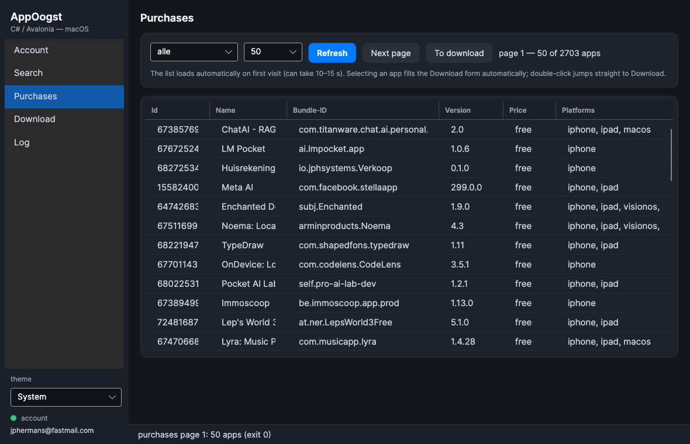
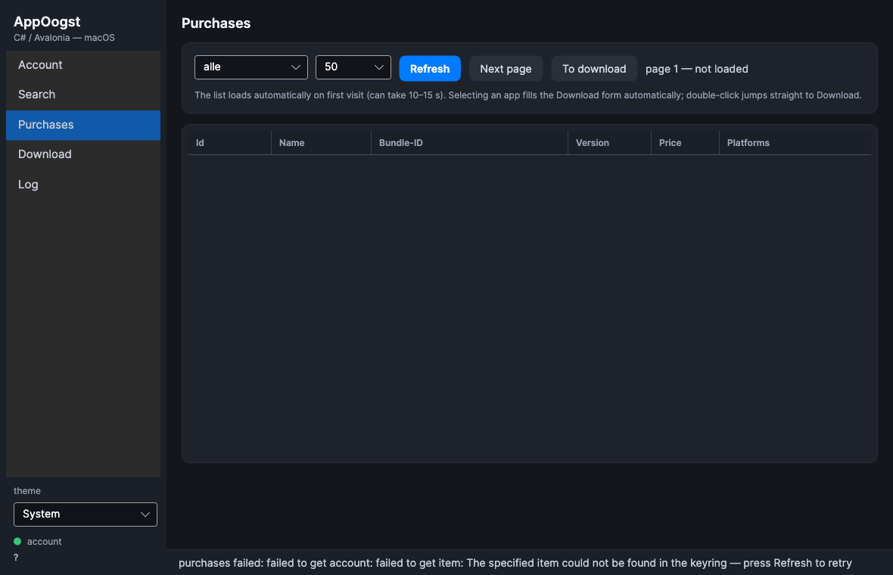

<p align="center">
  
</p>

# AppOogst

**AppOogst** (Dutch for *"app harvest"*) is a modern, dark-themed desktop app that lets you **harvest your own purchased App Store apps as `.ipa` files**. It is a friendly graphical front-end for the excellent open-source [ipatool](https://github.com/majd/ipatool) CLI, and it runs on **macOS, Windows and Linux** from one C# / Avalonia 12 codebase.

## Features

- **Account** — sign in / sign out; credentials are stored by ipatool itself (macOS Keychain, Linux Secret Service, or ipatool's encrypted config file) — AppOogst never sees or logs your password
- **Search** — search the App Store by term, platform and result limit; buy a license with one click
- **Purchases** — browse the apps tied to your Apple ID with pagination; the list auto-loads on first visit and shows totals like "page 1 — 50 of 2704 apps"
- **Select to fill** — selecting a purchase automatically fills the Download form (App ID, Bundle ID, platform); double-click jumps straight to Download
- **Download** — fetch the `.ipa` into any folder, optionally auto-buying a missing license (`--purchase`)
- **Action queue** — actions clicked while another action is running are queued (max 3) and run automatically — no lost clicks
- **Color-coded log** — commands in blue, errors in red, successes in green
- **Bundled ipatool** — the official binary ships inside every build and is self-repaired when the OS blocks it (see [Troubleshooting](#troubleshooting))
- **Headless verification** — built-in self-test, real-CLI probe, `--diagnose` and a `--shot` screenshot mode

## Screenshots

Purchases — the loaded list, with select-to-fill:



When the account is not signed in yet, the page says so instead of silently staying empty:



## Downloads

Grab a ready-to-run build from the [Releases](https://github.com/jphermans/AppOogst/releases) page — every `v*` tag triggers a GitHub Actions build:

| System | File | What you get |
|---|---|---|
| macOS (Apple Silicon) | `AppOogst-vX.Y.Z-osx-arm64.dmg` | real `AppOogst.app` (icon, ad-hoc signed) with the bundled macOS `ipatool` |
| Windows (64-bit) | `AppOogst-vX.Y.Z-win-x64.zip` | `AppOogst.exe` (single file) + `ipatool.exe` — no .NET or ipatool install needed |
| Linux (x86-64) | `AppOogst-vX.Y.Z-linux-x64.AppImage` | single-file AppImage with the bundled Linux `ipatool` |

All builds are **self-contained**: the .NET runtime is included, and so is the official [ipatool](https://github.com/majd/ipatool) binary (MIT). Nothing else has to be installed. A system-wide ipatool (Homebrew, apt, Scoop…) is used as a fallback if the bundled one cannot run.

## Install

### macOS (Apple Silicon)

Requires macOS 11 or newer. The build is **arm64 only** — there is no Intel slice.

1. Download `AppOogst-vX.Y.Z-osx-arm64.dmg` and open it.
2. Drag **AppOogst** onto the **Applications** folder in the window, then eject the disk image.
3. First launch only: macOS blocks ad-hoc signed apps. Either **right-click AppOogst → Open → Open**, or start it once, then allow it in **System Settings → Privacy & Security → “AppOogst” was blocked → Open Anyway**.

```bash
# same thing from the terminal, if you prefer
open /Applications/AppOogst.app
```

The app clears the download flag (`com.apple.quarantine`) from its bundled `ipatool` on first start — that is what makes sign-in work out of the box.

### Windows (64-bit)

Windows 10 or 11, x64.

1. Download `AppOogst-vX.Y.Z-win-x64.zip`.
2. **Extract the whole archive** to a folder of your choice, e.g. `%LOCALAPPDATA%\Programs\AppOogst`. Keep `AppOogst.exe` and `ipatool.exe` side by side — the app looks for `ipatool.exe` next to itself.
3. Run `AppOogst.exe`. If SmartScreen shows “Windows protected your PC”, choose **More info → Run anyway** (the build is unsigned).
4. Optional: right-click `AppOogst.exe` → **Send to → Desktop (create shortcut)** so it stays one click away.

Do not run it straight from inside the zip preview — Windows then extracts to a temporary folder and the bundled `ipatool.exe` is not where the app expects it.

### Linux (x86-64)

The AppImage needs **FUSE 2** and a glibc-based distribution (Ubuntu, Debian, Fedora, openSUSE, Arch…). On Ubuntu 22.04+/Debian 12 install it once with `sudo apt install libfuse2`.

```bash
mv ~/Downloads/AppOogst-vX.Y.Z-linux-x64.AppImage ~/Applications/AppOogst.AppImage
chmod +x ~/Applications/AppOogst.AppImage
~/Applications/AppOogst.AppImage
```

- No FUSE available (containers, locked-down hosts)? Run it unpacked instead:
  `~/Applications/AppOogst.AppImage --appimage-extract-and-run`
- Integrate it into your app menu with [AppImageLauncher](https://github.com/TheAssassin/AppImageLauncher), or drop a `.desktop` file in `~/.local/share/applications/` that points `Exec=` at the AppImage.
- On a musl distribution (Alpine) the bundled glibc `ipatool` cannot run: install ipatool from your package manager, and AppOogst will use that one.

## First run — sign in once

1. Open the **Account** page in the sidebar.
2. Enter your Apple ID e-mail and password, plus the 6-digit 2FA code if Apple asks for it, then press **Sign in**.
3. The status line switches to “Signed in as …”. The credentials stay with ipatool (Keychain / Secret Service / encrypted config) — close the app and it stays signed in.

Signing in needs an Apple ID that has App Store purchases. Only apps **you own** can be downloaded.

## Using AppOogst

1. **Search** for an app, or open **Purchases** to see everything tied to your Apple ID (`Next page` browses further).
2. Select a row — the **Download** form fills itself with App ID, Bundle ID and platform; double-click jumps straight to the Download page.
3. Pick a destination folder with **Browse** (default: your `Downloads` folder).
4. Press **Download start**. Progress and details appear on the **Log** page; the `.ipa` lands in the chosen folder.

The log is colour-coded (blue = command, green = success, red = error) and the first lines always name the ipatool binary in use and its version.

## Troubleshooting

Every command suddenly failing — sign-in included — is almost never an authentication problem: it is the bundled `ipatool` binary being refused by the OS. AppOogst repairs this on startup and says so in the log. For a plain-text report:

```bash
# macOS
/Applications/AppOogst.app/Contents/MacOS/AppOogst --diagnose
# Windows (PowerShell, in the folder you extracted to)
.\AppOogst.exe --diagnose
# Linux
~/Applications/AppOogst.AppImage --diagnose
```

- **macOS** — a downloaded `.app` carries `com.apple.quarantine` on every file, and macOS kills a quarantined helper at exec (`exit 137`). AppOogst clears the flag in place, or uses a private copy in `~/Library/Application Support/AppOogst/` when the bundle is read-only.
- **Windows** — the Mark-of-the-Web (`Zone.Identifier`) is removed from the bundled `ipatool.exe`; if you moved only `AppOogst.exe`, put `ipatool.exe` back next to it.
- **Linux** — nothing to strip; the executable bit is repaired if a manual unzip lost it.
- If the bundled helper is a build for another platform, AppOogst falls back to a system `ipatool` (Homebrew, apt, Scoop) and says so in the log.
- “2FA code is required” — enter the code Apple sent to your trusted device in the 2FA field and press Sign in again.
- “purchases failed: … the keyring …” / “The specified item could not be found” — ipatool has no signed-in account yet: sign in on the **Account** page, then press **Refresh** on Purchases (it reloads by itself right after a successful sign-in).
- Purchases can take 10–15 s (Apple's servers). The page label and the status bar report the outcome; a failure now names the reason instead of resetting to “ready”.

## Build from source

Requirements: [.NET SDK 11](https://dotnet.microsoft.com/download) (plus, on Linux, the usual Avalonia dependencies — `libx11`, `libice`, `libsm`, `fontconfig`). An Apple ID with purchases is only needed to download apps.

```bash
git clone https://github.com/jphermans/AppOogst.git
cd AppOogst
dotnet run
```

Self-contained single-file builds per platform:

```bash
# macOS (Apple Silicon) — then package the .app with scripts/build-macos-app.sh
dotnet publish -c Release -r osx-arm64 --self-contained true \
  -p:PublishSingleFile=true -p:IncludeNativeLibrariesForSelfExtract=true -o publish

# Windows
dotnet publish -c Release -r win-x64 --self-contained true \
  -p:PublishSingleFile=true -p:IncludeNativeLibrariesForSelfExtract=true -o publish

# Linux — then package with scripts/build-appimage.sh
dotnet publish -c Release -r linux-x64 --self-contained true \
  -p:PublishSingleFile=true -p:IncludeNativeLibrariesForSelfExtract=true -o publish
```

Drop the matching ipatool binary into `publish/` as `ipatool` (`ipatool.exe` on Windows) before packaging, or let the release workflow do it.

## Verification (no window required)

Works the same on every system — `dotnet run -- <flag>` from source, or the packaged binary as shown above:

```bash
--selftest   # argument building, JSON parsers, prefill, bundled-binary lookup + it actually running
--probe      # real CLI round-trip: auth info, search, list-purchases
--diagnose   # which ipatool is used, its version, whether it can execute, auth state
--shot /tmp/purchases.png --page purchases   # render any page to a PNG and exit
```

## How it works

AppOogst runs `ipatool --non-interactive --format json`, parses the JSON defensively and renders it in an Avalonia UI (Fluent, dark/light/system theme). All CLI arguments are passed as an argument list — never through a shell — and passwords are never written to the log. On startup the bundled helper is located, made executable (quarantine / Mark-of-the-Web / file mode repaired), and verified with `ipatool --version` before any command runs.

## Versioning

Releases are tagged with semantic version labels starting at `v0.1.0`. The version also lives in `AppOogst.csproj` as `<Version>`.

## License

[MIT](LICENSE) © 2026 Jean-Pierre Hermans

## Disclaimer

AppOogst is intended for backing up apps **you** have purchased. Use of ipatool must comply with Apple's terms of service; you are responsible for how you use this tool.
